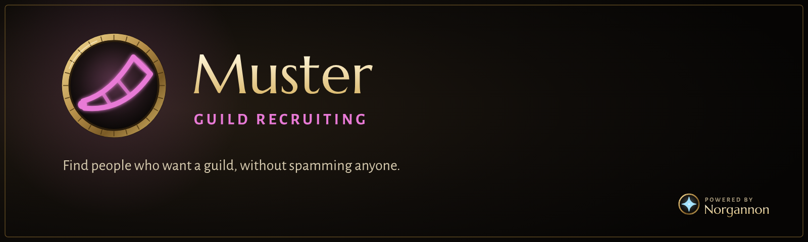

  

  
  
  

> [!WARNING]
> **Very much a work in progress.** This first stage has passed its test harness but hasn't been played in the game. Expect things to need fixing.

**Muster helps a guild recruit without becoming the thing everyone hates about guild recruiters.** It finds people worth
asking, asks each of them once, and remembers how it went.

Most recruiting add-ons compete on how many strangers they can reach. That gets recruiters reported, and it works badly anyway.
Muster sends less, and is better at who you ask and at not forgetting.

## What it does

### Find
People who said in chat that they're looking for a guild show first: they asked, so they're the best leads there are. Below them,
**Next** asks the game who's around, one level band per press, or **search** for exactly who you want ("priest 40-50", a zone, a name).
Only people without a guild are listed, and classes you need come first.
Anyone already asked, anyone who said no, and anyone you chose never to see stays hidden.

### Asking
Write your own message (right on Find, or several on the Asking tab), and **Whisper** sends it to one person, with their name, class and your guild filled in. You see exactly what
they'll read before you send. Each template shows how many people it reached, how many replied and how many joined.

### People
Everyone you've asked, with where they came from and what happened. A reply lights their row up, with an **Invite** button and room for
notes. A clear "no thanks" means they're never asked again. Without the right to invite, **Ask an officer** puts a line in guild chat for you.

### Adverts
Your own advert, and a button per channel you're already in. Muster never joins a channel for you, and never posts in the newcomers' channel.

### Results
Who joined, from where, through whom, and whether they're still in the guild after 7 and 30 days.

## What it won't do
- **Send anything without a click.** No auto-whispers, no queues, no "whisper everyone", no auto-welcome. One click sends one message to one person.
- **Scan in the background.** One press of Next is one `/who`.
- **Mass-invite, or invite out of nowhere.** Invite is for people who've answered. Shift-click overrides it, one person at a time.
- **Poach.** People in a guild never show.

There are limits too: one whisper every 15 seconds, 20 an hour (at most 40), one advert per channel every 15 minutes. You can make them stricter.

## Using it
`/muster` opens the window. `/muster add First Last` adds someone by hand, and `/muster status` says where things stand.
Needs NorgannonDB and NorgannonDB Core 1.17.

On WoW Forever, a whisper needs a character's first and last name. Muster keeps the fullest name it has seen for everyone.

## Coming later
Recruiters in one guild sharing who's been asked, handing a lead to someone who can invite, and Council's raid attendance in Results.

## Licence
All rights reserved. See [LICENSE](LICENSE).
